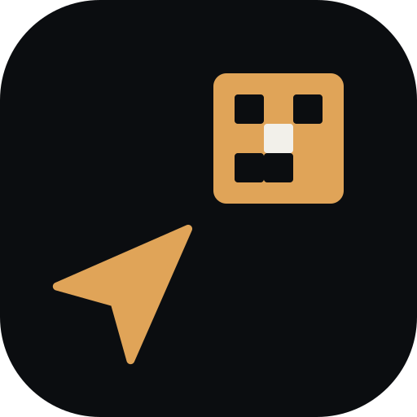

# Autonomous Robot Navigation System

<p align="center">
  
</p>

An ESP32-based autonomous robot navigation system that uses computer vision to detect Aruco markers and yellow objects, calculates distance and angle to targets, and controls a four-wheel robot for precise navigation.

## System Overview

This project consists of two main components:

1. **ESP32-CAM Object Detection** - Captures images, detects objects using AI, and sends navigation data
2. **ESP32-WROVER Robot Controller** - Receives navigation data and controls four motors for movement

## 🤖 AI Model & Computer Vision

### **TensorFlow Lite Object Detection Model**

This project uses a **TensorFlow Lite** model optimized for edge devices, specifically designed for real-time object detection on ESP32-CAM.

#### **Model Architecture & Specifications**

| Parameter | Value | Description |
|-----------|-------|-------------|
| **Model Type** | TensorFlow Lite | Optimized for embedded devices |
| **Inference Engine** | EI_CLASSIFIER_TFLITE | Edge Impulse TensorFlow Lite runtime |
| **Input Resolution** | 96×96 pixels | RGB image input |
| **Input Format** | INT8 Quantized | 8-bit quantization for efficiency |
| **Output Format** | INT8 Quantized | Optimized for ESP32 memory |
| **Model Size** | ~289KB | Compact for embedded deployment |
| **Arena Size** | 289,580 bytes | Memory allocation for inference |
| **Detection Classes** | 3 | Robot, Robot Sidewards, X (target) |

#### **Object Detection Capabilities**

The model can detect and classify:
- **"Robot"** - Main robot chassis identification
- **"Robot Sidewards"** - Robot viewed from side angles  
- **"X"** - Target objects (Aruco markers, yellow objects)

#### **Detection Parameters**

| Parameter | Value | Description |
|-----------|-------|-------------|
| **Detection Threshold** | 0.5 (50%) | Minimum confidence for detection |
| **Max Detections** | 10 objects | Maximum objects detected per frame |
| **NMS IOU Threshold** | 0.2 | Non-maximum suppression overlap |
| **NMS Confidence** | 0.0 | NMS confidence threshold |

#### **Performance Characteristics**

- **Inference Time**: ~1ms per frame (optimized for real-time)
- **Memory Usage**: ~290KB RAM during inference
- **Quantization**: INT8 for 4x memory reduction vs FP32
- **Model Optimization**: Pruned and quantized for ESP32

### **Training & Development**

#### **Training Platform**
- **Edge Impulse Studio** v1.71.25
- **Project ID**: 666401
- **Owner**: Akhil Mittapalli
- **Model Version**: 2

#### **Training Data**
- **Input Frames**: 1 frame per inference
- **Raw Sample Count**: 9,216 samples
- **DSP Input Size**: 9,216 bytes
- **Feature Extraction**: RGB image processing

#### **Model Optimization**
- **Quantization Enabled**: Yes (INT8)
- **Compiled Model**: No (interpreted TensorFlow Lite)
- **Custom Ops**: No (standard TFLite ops only)
- **Memory Optimization**: Arena-based allocation

### **Technical Implementation**

#### **DSP Pipeline**
```cpp
// Image preprocessing pipeline
ei_dsp_config_image_t ei_dsp_config_2 = {
    2,                    // Block ID
    1,                    // Implementation version
    1,                    // Axes count
    "RGB"                 // Color channels
};
```

#### **Inference Configuration**
```cpp
// TensorFlow Lite graph configuration
ei_config_tflite_graph_t ei_config_tflite_graph_3 = {
    .implementation_version = 1,
    .model = tflite_learn_3,
    .model_size = tflite_learn_3_len,
    .arena_size = tflite_learn_3_arena_size
};
```

#### **Object Detection Output**
```cpp
// Detection categories
const char* ei_classifier_inferencing_categories[] = { 
    "Robot", 
    "Robot Sidewards", 
    "X" 
};
```

## Project Structure

```
Autonomous_Robot_Project/
├── ESP32_CAM_Object_Detection.ino    # ESP32-CAM vision and detection code
├── ESP32_WROVER_Robot_Controller.ino # ESP32-WROVER motor control code
├── config.h                          # Configuration file (edit this!)
├── Object_Detection_v2_inferencing/  # AI model for object detection
│   ├── src/
│   │   ├── model-parameters/         # Model metadata and configuration
│   │   ├── tflite-model/            # TensorFlow Lite model files
│   │   └── edge-impulse-sdk/        # Edge Impulse inference engine
│   └── examples/                     # Platform-specific examples
└── README.md                         # This file
```

## Quick Setup

### 1. Configuration

**IMPORTANT**: Before uploading any code, you need to set up your configuration:

1. **Copy the example config file**:
   ```bash
   cp config.example.h config.h
   ```

2. **Edit `config.h` with your settings**:
   ```cpp
   // WiFi Configuration
   #define WIFI_SSID "your_wifi_network_name"
   #define WIFI_PASSWORD "your_wifi_password"

   // Network Configuration  
   #define WROVER_IP_ADDRESS "192.168.197.10"  // Your WROVER's IP address
   #define WROVER_PORT 8080

   // Camera and Motor Settings
   #define PIXELS_TO_CM 0.1                    // Camera calibration
   #define MIN_SPEED 150                       // Minimum motor speed
   #define MAX_SPEED 200                       // Maximum motor speed
   ```

**Security Note**: The `config.h` file is in `.gitignore` to prevent accidentally committing your WiFi credentials. Always use `config.example.h` as a template.

### 2. Hardware Setup

#### ESP32-CAM (Object Detection)
- ESP32-CAM AI-Thinker module
- Camera module (OV2640)
- USB-TTL converter for programming

#### ESP32-WROVER (Robot Controller)
- ESP32-WROVER module
- 4x DC motors with motor drivers
- 4-wheel robot chassis
- Power supply (battery or external)

#### Motor Connections
```
Motor A (Front Left):  ENA=23, IN1=5,  IN2=4
Motor B (Front Right): ENB=22, IN3=2,  IN4=15  
Motor C (Rear Left):   ENC=13, IN5=19, IN6=21
Motor D (Rear Right):  END=14, IN7=27, IN8=26
```

### 3. Software Setup

#### Required Libraries
Install these libraries in Arduino IDE:
- `ArduinoJson` by Benoit Blanchon
- `ESP32 Camera` (built into ESP32 board package)
- `WiFi` (built into ESP32 board package)
- `WebServer` (built into ESP32 board package)

#### AI Model Installation
The project includes a pre-trained TensorFlow Lite model:
1. Copy `Object_Detection_v2_inferencing/` to your Arduino libraries folder
2. The model is automatically included when you include the library
3. No additional TensorFlow installation required

### 4. Upload Process

1. **Upload ESP32-WROVER code first**:
   - Open `ESP32_WROVER_Robot_Controller.ino`
   - Select ESP32-WROVER board
   - Upload and note the IP address from Serial Monitor

2. **Update config.h with WROVER IP**:
   - Replace `WROVER_IP_ADDRESS` with the IP shown in Serial Monitor

3. **Upload ESP32-CAM code**:
   - Open `ESP32_CAM_Object_Detection.ino`
   - Select ESP32-CAM AI-Thinker board
   - Upload the code

## How It Works

### Object Detection (ESP32-CAM)
1. **Image Capture**: Captures 96×96 RGB images from camera
2. **Preprocessing**: Resizes and normalizes images for model input
3. **AI Inference**: Runs TensorFlow Lite model for object detection
4. **Post-processing**: Extracts bounding boxes and confidence scores
5. **Navigation Calculation**: Computes distance and angle to targets
6. **Data Transmission**: Sends JSON data to WROVER via HTTP POST

### Robot Control (ESP32-WROVER)
1. **Data Reception**: Receives position data from ESP32-CAM
2. **Navigation Logic**: Calculates optimal motor movements based on:
   - Distance to target (forward/backward)
   - Angle to target (left/right rotation)
3. **Motor Control**: Controls four motors for precise navigation
4. **Web Interface**: Provides real-time monitoring dashboard

### Navigation Logic
- **Distance Control**: Maintains target distance (10cm ± 2cm)
- **Angle Control**: Adjusts orientation to face target
- **Speed Control**: Faster movement when further from target
- **Safety**: Stops motors if no recent data (5+ seconds)

## Model Performance & Optimization

### **Memory Efficiency**
- **Model Size**: 289KB (compressed TensorFlow Lite)
- **Runtime Memory**: ~290KB arena allocation
- **Quantization**: INT8 reduces memory by 75% vs FP32
- **Optimization**: Pruned for minimal operations

### **Speed Optimization**
- **Inference Time**: ~1ms per frame
- **Frame Rate**: Up to 1000 FPS (theoretical)
- **Real-time Capable**: Suitable for autonomous navigation
- **Optimized Ops**: Standard TensorFlow Lite operations only

### **Accuracy Considerations**
- **Detection Threshold**: 50% confidence minimum
- **Training Data**: Edge Impulse optimized dataset
- **Quantization Impact**: Minimal accuracy loss with INT8
- **Environmental Factors**: Lighting, distance, angle affect detection

## Configuration Options

### Camera Settings
- `PIXELS_TO_CM`: Calibrate based on your camera height and resolution
- Adjust `frame_size` in camera config for different resolutions
- Model expects 96×96 input - automatic resizing applied

### Motor Settings
- `MIN_SPEED`/`MAX_SPEED`: Adjust motor speed range (0-255)
- `MOTOR_UPDATE_INTERVAL`: How often to update motor control (ms)

### Navigation Thresholds
- `TARGET_DISTANCE`: Ideal distance to maintain (cm)
- `DISTANCE_THRESHOLD`: Acceptable distance range (cm)
- `ANGLE_THRESHOLD_PRECISE`/`WIDE`: Angle thresholds for movement

### Network Settings
- `WROVER_PORT`: HTTP server port (default: 8080)
- `DEBUG_MODE`: Enable/disable debug prints

### AI Model Settings
- **Detection Threshold**: 0.5 (adjustable in model metadata)
- **Max Objects**: 10 (configurable in model)
- **NMS Threshold**: 0.2 (non-maximum suppression)

## Monitoring and Debugging

### Web Interface
Access the robot's web interface at: `http://[WROVER_IP]:8080`
- Real-time position data
- Auto-refreshing display
- JSON API endpoint at `/data`

### Serial Monitor
Both devices output debug information:
- WiFi connection status
- Object detection results with confidence scores
- Motor control decisions
- Network communication status
- Model inference timing

### Model Performance Monitoring
```cpp
// Example debug output
ei_printf("Object Detection Results (DSP: %d ms., Classification: %d ms.): \n",
          result.timing.dsp, result.timing.classification);
```

## Common Issues

### AI Model Issues
1. **No object detection**:
   - Check lighting conditions (model trained on specific lighting)
   - Ensure objects are in camera view (96×96 field of view)
   - Verify model files are properly installed
   - Check detection threshold (default 0.5)

2. **Poor detection accuracy**:
   - Adjust camera distance and angle
   - Improve lighting conditions
   - Check for object occlusion
   - Verify object matches training data

3. **Slow inference**:
   - Check ESP32-CAM clock speed
   - Verify sufficient power supply
   - Monitor memory usage
   - Check for background tasks

### Hardware Issues
1. **Motors not responding**:
   - Check motor connections
   - Verify power supply
   - Check motor driver connections

2. **Network communication issues**:
   - Verify WiFi credentials in `config.h`
   - Check IP address configuration
   - Ensure both devices are on same network

## Model Training & Customization

### **Training Your Own Model**
1. **Data Collection**: Use Edge Impulse Studio for data collection
2. **Labeling**: Label objects as "Robot", "Robot Sidewards", "X"
3. **Training**: Use Edge Impulse's automated training pipeline
4. **Export**: Download TensorFlow Lite model for ESP32
5. **Deploy**: Replace model files in the project

### **Model Customization Options**
- **Input Resolution**: Can be changed (requires retraining)
- **Detection Classes**: Add/remove object types
- **Confidence Threshold**: Adjust detection sensitivity
- **Model Architecture**: Choose different neural network types

### **Performance Tuning**
- **Quantization**: Balance accuracy vs memory usage
- **Pruning**: Remove unnecessary model weights
- **Optimization**: Use TensorFlow Lite optimization tools
- **Hardware**: Consider ESP32-S3 for better AI performance

## Security Notes

⚠️ **Important Security Considerations**:

1. **WiFi Credentials**: Never commit `config.h` with real credentials to version control
2. **Network Security**: This system uses unencrypted HTTP - not suitable for public networks
3. **Access Control**: No authentication on web interface - secure your local network
4. **Model Security**: TensorFlow Lite models can be reverse-engineered - protect proprietary models

### Recommended Security Practices:
- Use a dedicated WiFi network for robot testing
- Change default passwords and network names
- Keep firmware updated
- Monitor network traffic
- Consider HTTPS for production deployments

## Troubleshooting

### ESP32-CAM Issues
- **Upload problems**: Use proper USB-TTL converter and correct wiring
- **Camera not working**: Check camera module connections
- **WiFi issues**: Verify credentials and signal strength
- **Model loading**: Check library installation and file paths

### ESP32-WROVER Issues  
- **Motor control**: Check motor driver connections and power supply
- **Web server**: Verify port isn't blocked by firewall
- **Communication**: Check IP address and network connectivity

### AI Model Issues
- **Memory errors**: Check ESP32-CAM has sufficient RAM
- **Inference errors**: Verify model files are complete
- **Detection issues**: Check lighting and object positioning

## Contributing

This project is open for improvements! Areas for enhancement:
- **AI Improvements**: Better object detection models
- **Navigation**: More sophisticated pathfinding algorithms
- **Hardware**: Support for different camera modules and sensors
- **Software**: Mobile app for remote control
- **Performance**: Optimize inference speed and accuracy

## License

This project is provided as-is for educational and research purposes. 

**Important**: The included TensorFlow Lite model is licensed under Edge Impulse Terms of Service. For commercial use, please refer to Edge Impulse's licensing requirements.

### **Model Attribution**
- **Platform**: Edge Impulse Studio v1.71.25
- **Project**: Object Detection v2 (ID: 666401)
- **Owner**: Akhil Mittapalli
- **License**: Edge Impulse Terms of Service

## Support

For issues and questions:
1. Check the troubleshooting section above
2. Verify all hardware connections
3. Review configuration settings
4. Check Serial Monitor for error messages
5. Consult Edge Impulse documentation for model issues

---

**Happy Robot Building! 🤖** 